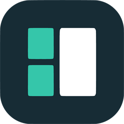

  
  <h1>Dashia</h1>
  
<b>Modern, Lightweight & Customizable Android Car Launcher</b>

  
Designed for all Android automotive multimedia head units

---

# 🇹🇷 Türkçe

## 🚗 Genel Bakış
**Dashia**, tüm Android araç multimedya ekranları için geliştirilmiş; düşük bellek tüketimi, yüksek kontrastlı sürüş ergonomisi ve tam özelleştirilebilir kokpit düzeni sunan açık kaynaklı ve yüksek performanslı bir Car Launcher (Araç Başlatıcısı) uygulamasıdır.

## ✨ Özellikler

- **🧩 Modüler ve Boyutlandırılabilir Kokpit Düzeni**
  - Herhangi bir پanele uzun basarak widget'ları anında değiştirin (`Saat`, `GPS Hız Göstergesi`, `Medya Kontrolcüsü`, `Canlı Harita` veya `Gizli`).
  - Paneller arasındaki ayırıcı çizgileri sürükleyerek boyutları dilediğiniz gibi ayarlayın veya Ayarlar'dan boyutlandırma çubuklarını gizleyerek düzeni kilitleyin.
- **🗺️ Akıcı 60 FPS Canlı Harita ve Çevrimdışı OSM Motoru**
  - **OpenStreetMap** (ücretsiz, API anahtarı gerektirmez) ve **Google Maps SDK** desteği.
  - **60 FPS Akıcı İkon ve Açı İnterpolasyonu**: Ham 1 Hz GPS verileri arasında takılarak atlamak yerine, araç ikonunu ve yol dönüş açısını 60 FPS akıcılıkta süzülerek hareket ettirir.
  - **5 Özel Kokpit Harita Teması**: *Açık (Light)*, *Standart Koyu (Standard Dark)*, *AMOLED Tam Siyah*, *Gece Mavisi Kokpit (Midnight Cockpit Blue)* ve *Sıcak Kehribar (Warm Amber)*.
  - **Dahili Çevrimdışı Bölge İndirici**: SIM kartı olmayan multimedya cihazlarında %100 internetsiz navigasyon için şehir/bölge haritalarını doğrudan cihaz hafızasına indirin.
- **🎵 Evrensel Medya Oturumu Kontrolcüsü**
  - Spotify, YouTube Music, Poweramp, AIMP, Bluetooth A2DP müzik akışı ve yerleşik FM Radyo uygulamalarını destekleyen yerel `NotificationListenerService` + `MediaSessionManager` köprüsü.
  - Geç yanıt veren medya oynatıcılar için otomatik yeniden deneme mekanizması ve gerçek zamanlı albüm kapağı çekme özelliği.
- **🎨 Tema Motoru, Material You ve Özel Yazı Tipleri**
  - Hazır temalar (*Obsidian Red*, *Material You*, *Carbon Blue*, *Cockpit Amber*, *Emerald*, *Daylight*) ve tüm temalarla (Material You dahil) uyumlu **Özel HEX Renk Seçici**.
  - 6 dahili kokpit fontu + cihaz hafızasından **Özel `.ttf` / `.otf` Font Yükleyici**.
- **🚀 Özelleştirilebilir Hızlı Dock (0–6 Kısayol)**
  - Alt barı 0 ile 6 uygulama arasında yapılandırın; özel isimler, dahili vektörel ikonlar veya **galeriden özel görseller (`.png` / `.jpg`)** atayın.
- **🌍 6 Dahili Dil Desteği**
  - **Türkçe**, **English**, **Deutsch**, **Français**, **Español**, **Русский**.

## 📦 Kurulum ve Kullanım

### 1. Araç Multimedya Cihazına Kurulum (APK)
Uygulamayı kod derlemeden doğrudan aracınızın multimedya ekranına veya Android tabletinize kurmak için:

1. **APK İndirin:** Sağ taraftaki [**Releases**](../../releases) bölümünden en güncel `Dashia-v1.0.0.apk` dosyasını indirin ve USB bellek veya tarayıcı ile multimedya cihazınıza aktarıp kurun.
2. **Konum İzni (GPS & Harita):** İlk açılışta hız göstergesi ve canlı haritanın çalışması için konum iznini **"Her zaman / Uygulama kullanılırken izin ver"** olarak onaylayın.
3. **Müzik & Medya Kontrolü İzni:** Spotify, YouTube Music, Bluetooth müzik ve Radyo bilgilerini (şarkı adı ve albüm kapağı) okumak için **Dashia Ayarları → Medya → Bildirim Erişimi Ver** butonuna dokunup listeden **Dashia**'yı aktif edin.
4. **Varsayılan Ana Ekran (Home Launcher) Yapma:** Aracın kontağı açıldığında veya cihazdaki **Home (Ev)** tuşuna basıldığında doğrudan Dashia'nın açılması için **Dashia Ayarları → Sistem → Varsayılan Ana Ekran** seçeneğinden varsayılan başlatıcı olarak **Dashia**'yı seçin.
5. **Çevrimdışı Harita İndirme (İnternetsiz Kullanım):** Multimedya cihazınızda SIM kart yoksa, ev veya telefon Wi-Fi bağlantısı açıkken **Dashia Ayarları → Harita → Çevrimdışı Harita İndir** bölümünden bulunduğunuz şehri seçip indirin.

---

# 🇬🇧 English

## 🚗 Overview
**Dashia** is an open-source, high-performance Android Car Launcher engineered specifically for universal in-car Android multimedia head units. Built with driving ergonomics, a low memory footprint, and deep customization in mind.

## ✨ Key Features

- **🧩 Modular & Resizable Cockpit Layout**
  - Long-press any dashboard slot to swap widgets (`Clock`, `GPS Speedometer`, `Media Controller`, `Live Map`, or `Hidden`).
  - Drag the interactive dividers to resize panels on the fly, or lock the layout by hiding resize handles in Settings.
- **🗺️ Smooth 60 FPS Live Map & Offline OSM Engine**
  - Supports **OpenStreetMap** (free, no API key required) and **Google Maps SDK**.
  - **60 FPS Smooth Marker & Bearing Interpolation**: Smoothly glides your vehicle marker and road rotation along the route instead of jumping between raw 1 Hz GPS ticks.
  - **5 Custom Cockpit Map Themes**: *Light*, *Standard Dark*, *AMOLED Pure Black*, *Midnight Cockpit Blue*, and *Warm Amber*.
  - **Built-in Offline Region Downloader**: Download city/region tiles directly to device storage for 100% offline navigation on head units without SIM cards.
- **🎵 Universal Media Session Controller**
  - Native `NotificationListenerService` + `MediaSessionManager` bridge supporting Spotify, YouTube Music, Poweramp, AIMP, Bluetooth A2DP streaming, and stock FM Radio apps.
  - Real-time album art extraction with automatic metadata retry for delayed players.
- **🎨 Theme Engine, Material You & Custom Fonts**
  - Presets (*Obsidian Red*, *Material You*, *Carbon Blue*, *Cockpit Amber*, *Emerald*, *Daylight*) plus a full **Custom HEX Color Picker** (works across all themes including Material You).
  - 6 built-in cockpit typefaces + **Custom `.ttf` / `.otf` Font Loader** from device storage.
- **🚀 Customizable Quick Dock (0–6 Shortcuts)**
  - Configure between 0 and 6 bottom dock apps with custom labels, built-in vector icons, or **custom gallery images (`.png` / `.jpg`)**.
- **🌍 6 Languages Built-in**
  - **Türkçe**, **English**, **Deutsch**, **Français**, **Español**, **Русский**.

## 📦 Getting Started

### 1. Direct APK Installation (For Car Head Units & Tablets)
To install Dashia directly on your vehicle's multimedia screen or Android tablet without building from source:

1. **Download APK:** Download the latest `Dashia-v1.0.0.apk` from the [**Releases**](../../releases) section and install it via USB drive or browser.
2. **Location Permission (GPS & Map):** On first launch, grant Location Permission (**"Allow all the time"** or **"While using the app"**) for the GPS speedometer and live map to function.
3. **Media Control Permission:** To read track info and album art from Spotify, YouTube Music, Bluetooth audio, and FM Radio, go to **Dashia Settings → Media → Grant Notification Access** and enable **Dashia**.
4. **Set as Default Home Launcher:** To launch Dashia automatically when you turn the ignition on or press the **Home** button, go to **Dashia Settings → System → Default Home Launcher** and select **Dashia**.
5. **Download Offline Maps:** If your head unit doesn't have a SIM card, connect to Wi-Fi/Hotspot once and go to **Dashia Settings → Map → Offline Map Downloader** to download your city/region for 100% offline use.

---

#### Gereksinimler / Prerequisites
- Flutter SDK `^3.11.0`
- Android SDK (API 23+ / Android 6.0+)

---

## 📄 License

Distributed under the [MIT License](LICENSE).
